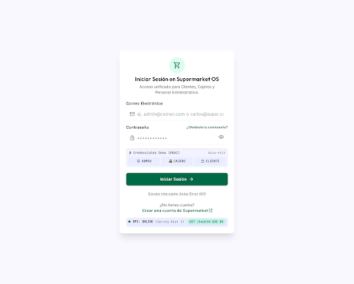
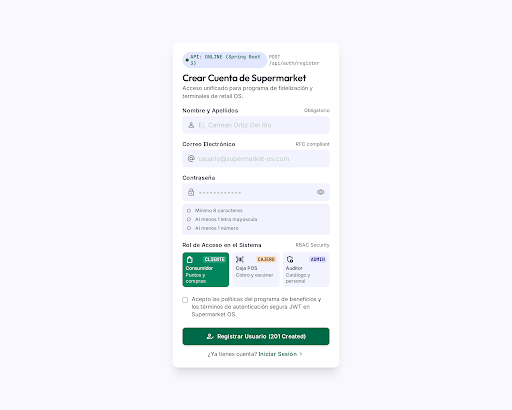
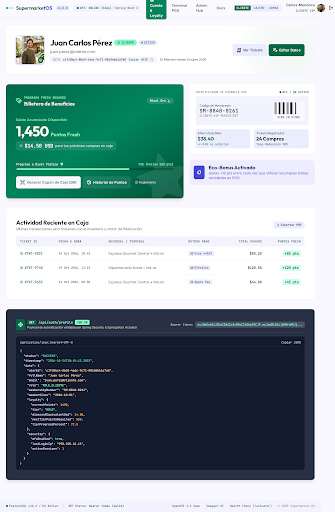
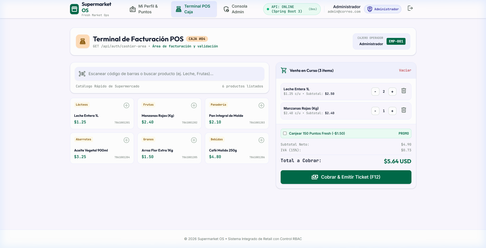
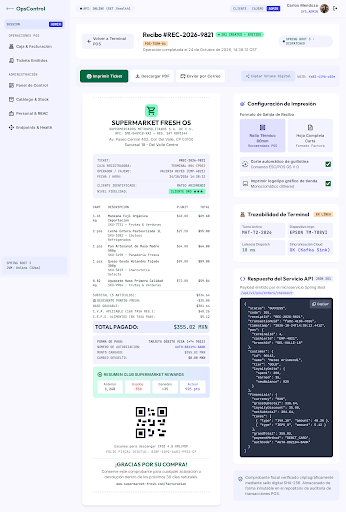
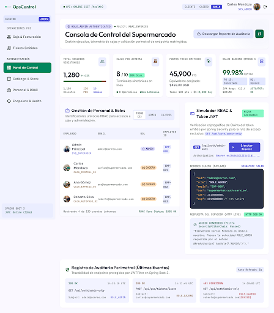
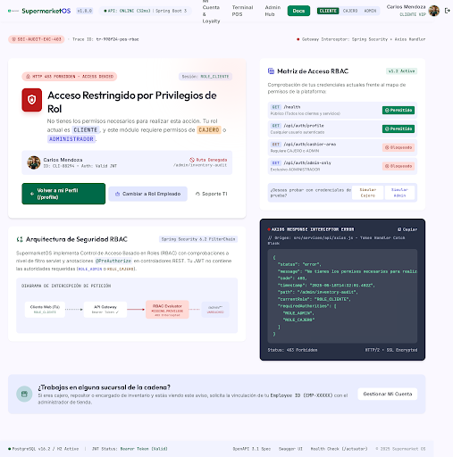

# 🛒 Supermarket OS — Sistema Integrado de Supermercado & Control de Acceso (RBAC)

> **Proyecto de Ingeniería Web — Evaluación Práctica y Documentación Técnica**  
> **Backend:** Java 17 + Spring Boot 3.2.5 + Spring Security 6 (JWT) + Hibernate JPA + Base de Datos H2 / PostgreSQL  
> **Frontend:** React 19 + Vite 8 + Tailwind CSS v4 + Stitch UI Components  
> **Autor:** J7pultra  

---

## 📌 Tabla de Contenidos
1. [Descripción General](#-descripción-general)
2. [Arquitectura del Proyecto](#-arquitectura-del-proyecto)
3. [📸 Galería de la Aplicación Funcionando](#-galería-de-la-aplicación-funcionando)
4. [⚡ Guía de Ejecución Rápida (Para el Docente / Evaluador)](#-guía-de-ejecución-rápida-para-el-docente--evaluador)
5. [🔑 Credenciales de Prueba (Demo RBAC)](#-credenciales-de-prueba-demo-rbac)
6. [📡 Referencia de Endpoints del Backend](#-referencia-de-endpoints-del-backend)
7. [📑 Documentos de Arquitectura y Diseño](#-documentos-de-arquitectura-y-diseño)

---

## 📖 Descripción General

**Supermarket OS** es una solución integral full-stack para la gestión de un supermercado moderno. El sistema implementa un modelo de seguridad basado en roles (**RBAC**) con tokens criptográficos JWT y desacoplamiento total entre frontend y backend:

- **Rol CLIENTE:** Experiencia de compra autoservicio, consulta de saldo de **Puntos Fresh** acumulados, barra de progreso a niveles VIP (Platino) y código QR para canje en caja.
- **Rol CAJERO:** Terminal de Punto de Venta (**POS**) con catálogo rápido, escaneo simulado de código de barras, cálculo de subtotales, IVA (15%), canje de puntos de fidelidad y emisión de ticket electrónico con QR.
- **Rol ADMINISTRADOR:** Consola de gobernanza con indicadores KPI en tiempo real (usuarios, puntos, cajas), gestión de personal con `Employee ID` y telemetría de seguridad.

---

## 🏛 Arquitectura del Proyecto

El repositorio está organizado como un monorepo limpio y estructurado:

```
Prouecto ingenieria web/
├── SupermarketApi/                 # Backend RESTful en Spring Boot 3
│   ├── src/main/java/com/supermarket/api/
│   │   ├── config/                 # Configuración general
│   │   ├── controller/             # Controladores REST (/api/auth, /health)
│   │   ├── dto/                    # Objetos de transferencia y contratos JSON
│   │   ├── entity/                 # Entidades JPA (User, Role)
│   │   ├── exception/              # GlobalExceptionHandler (@RestControllerAdvice)
│   │   ├── repository/             # Spring Data JPA Repositories
│   │   ├── security/               # Filtros JWT y SecurityFilterChain
│   │   └── service/                # Lógica de negocio (AuthService)
│   ├── src/main/resources/         # application.properties y base H2
│   ├── pom.xml                     # Maven Dependencies
│   └── mvnw / mvnw.cmd             # Maven Wrapper ejecutable
│
├── frontend-app-ing-web/           # Frontend SPA en React 19 + Vite
│   ├── src/
│   │   ├── api/                    # Cliente Axios + Interceptor Bearer JWT
│   │   ├── components/             # Componentes modulares (Atoms, Molecules, POS)
│   │   ├── layouts/                # AuthLayout y MainLayout con Navbar RBAC
│   │   ├── pages/                  # Vistas: Login, Register, Profile, POS, Admin, 403
│   │   ├── routes/                 # AppRouter y ProtectedRoute con guards
│   │   └── store/                  # AuthContext y CartContext
│   ├── package.json
│   └── vite.config.js
│
├── screenshots/                    # Capturas de pantalla del sistema en ejecución
├── SISTEMA_DE_DISENO_SUPERMARKET_API.md  # Especificación oficial de Design Tokens
├── PLAN_INTEGRACION_STITCH_FRONTEND.md   # Hoja de ruta de integración
└── ESTADO_DEL_PROYECTO.md                # Bitácora de seguimiento de fases
```

---

## 📸 Galería de la Aplicación Funcionando

A continuación se muestran las capturas de pantalla reales de la aplicación web en funcionamiento:

### 1. Pantalla de Acceso & Login (`/login`)
*Formulario con credenciales demo interactivas de 1 clic, botón de visibilidad de contraseña y detector en vivo del estado de la API.*



---

### 2. Registro Inteligente Multirrol (`/register`)
*Selector interactivo de tarjetas de rol (Cliente, Cajero, Administrador), validador dinámico de contraseña en vivo (mín. 8 caracteres, 1 mayúscula, 1 número) y campo de `Employee ID` que aparece condicionalmente solo para empleados.*



---

### 3. Perfil de Usuario & Puntos de Lealtad (`/profile`)
*Tarjeta de lealtad Fresh Rewards con puntos acumulados, cálculo de descuento en dólares, barra de progreso a Nivel Platino, código QR escaneable en caja y UUID copiable con un clic.*



---

### 4. Terminal de Facturación POS de Cajero (`/cashier`)
*Área de cobro con catálogo de abarrotes, lector simulado de códigos de barras, tabla interactiva de items con cantidades dinámicas, desglose de IVA (15%), canje de puntos y botón de cobro F12.*



---

### 5. Comprobante Electrónico de Caja (Ticket Imprimible)
*Ticket de caja con desglose de productos, datos del operador, cálculo de impuestos, código QR para facturación electrónica y botón de impresión.*



---

### 6. Consola de Mando Administrativo (`/admin`)
*Panel exclusivo para rol ADMIN con tarjetas de métricas KPI, tabla de gestión de personal con `Employee ID`, estado de turnos y pestaña de auditoría de seguridad JWT.*



---

### 7. Control de Acceso y Seguridad (`HTTP 403 Forbidden`)
*Pantalla de excepción cuando un usuario intenta acceder a una ruta para la que no tiene permisos de rol (ej. Cliente intentando ingresar a `/admin` o `/cashier`).*



---

## ⚡ Guía de Ejecución Rápida (Para el Docente / Evaluador)

Para probar el proyecto completo se requieren **dos terminales abiertas**:

### Terminal 1: Iniciar el Backend (`SupermarketApi`)
```bash
# 1. Navegar a la carpeta del backend
cd SupermarketApi

# 2. Ejecutar con Maven Wrapper (No requiere instalar Maven ni Docker)
# En Windows:
.\mvnw.cmd spring-boot:run

# En Linux / macOS:
./mvnw spring-boot:run
```
> La API arrancará en: **`http://localhost:3000`**  
> Health check: **`http://localhost:3000/health`**  
> Consola de base de datos H2: **`http://localhost:3000/h2-console`** *(JDBC URL: `jdbc:h2:mem:supermercado_db`, Usuario: `sa`, Contraseña en blanco)*

---

### Terminal 2: Iniciar el Frontend (`frontend-app-ing-web`)
```bash
# 1. Navegar a la carpeta del frontend
cd frontend-app-ing-web

# 2. Instalar dependencias
npm install

# 3. Iniciar el servidor de desarrollo
npm run dev
```
> El frontend abrirá en: **`http://localhost:5173`**

---

## 🔑 Credenciales de Prueba (Demo RBAC)

La pantalla de login incluye una barra de **Auto-fill de 1 Clic** para facilitar las pruebas del evaluador:

| Rol | Correo Electrónico | Contraseña | Privilegios y Vistas Disponibles |
| :--- | :--- | :--- | :--- |
| **`ADMIN`** | `admin@correo.com` | `Admin1234` | Acceso total a `/admin`, `/cashier` y `/profile` |
| **`CAJERO`** | `cajero@correo.com` | `Password123` | Acceso a `/cashier` (Terminal POS) y `/profile` |
| **`CLIENTE`** | `cliente@correo.com` | `Password123` | Acceso a autoservicio y `/profile` (Puntos Fresh) |

---

## 📡 Referencia de Endpoints del Backend

| Método | Endpoint | Acceso Requerido | Descripción |
| :--- | :--- | :--- | :--- |
| `GET` | `/health` | Público | Comprueba la disponibilidad y salud del servidor |
| `POST` | `/api/auth/register` | Público | Registro de clientes o personal (`employeeId` obligatorio si es empleado) |
| `POST` | `/api/auth/login` | Público | Autentica credenciales y emite el token JWT Bearer |
| `GET` | `/api/auth/profile` | Autenticado | Retorna el UUID y rol del usuario conectado |
| `GET` | `/api/auth/cashier-area` | `CAJERO` o `ADMIN` | Área de facturación y validación de cobro en caja |
| `GET` | `/api/auth/admin-only` | `ADMIN` | Consola maestra de gestión y auditoría |

---

## 📑 Documentos de Arquitectura y Diseño

Para una revisión más detallada del proceso de ingeniería, consulta los siguientes documentos en la raíz del repositorio:

1. 📄 **[SISTEMA_DE_DISENO_SUPERMARKET_API.md](SISTEMA_DE_DISENO_SUPERMARKET_API.md):** Guía exhaustiva de tokens de diseño, contrastes WCAG AA, tipografías y especificaciones de componentes.
2. 📄 **[PLAN_INTEGRACION_STITCH_FRONTEND.md](PLAN_INTEGRACION_STITCH_FRONTEND.md):** Plan maestro de integración de pantallas Stitch a React modular.
3. 📄 **[ESTADO_DEL_PROYECTO.md](ESTADO_DEL_PROYECTO.md):** Bitácora con el 100% de las fases y componentes auditados.

---

> Desarrollado con ❤️ para el proyecto de **Ingeniería Web**.
