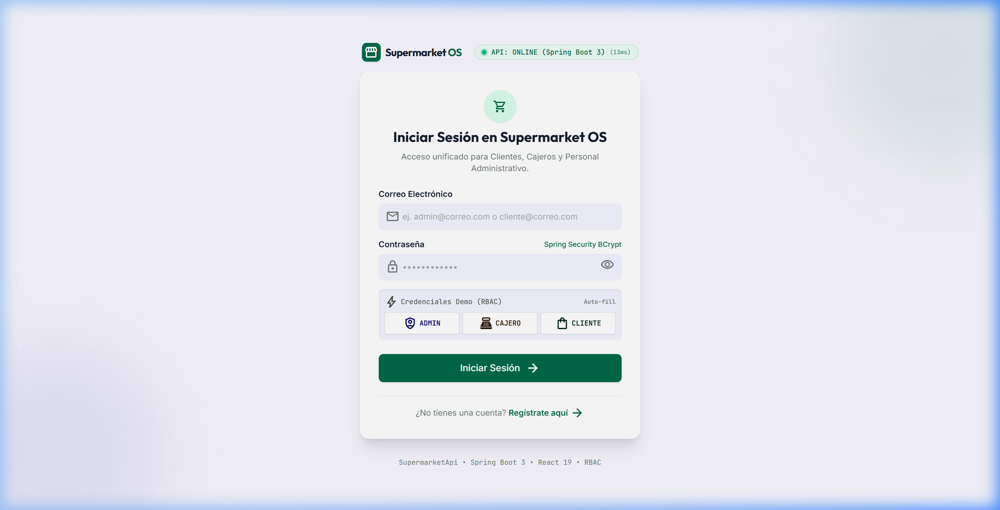
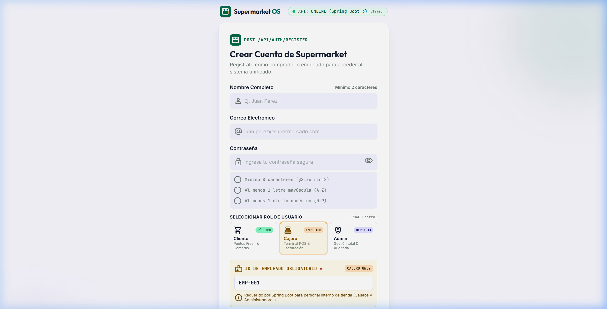
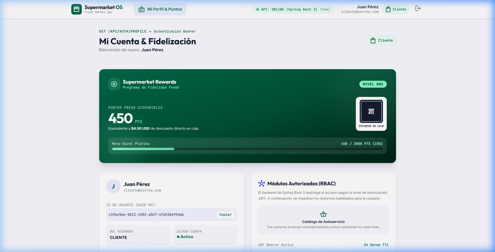
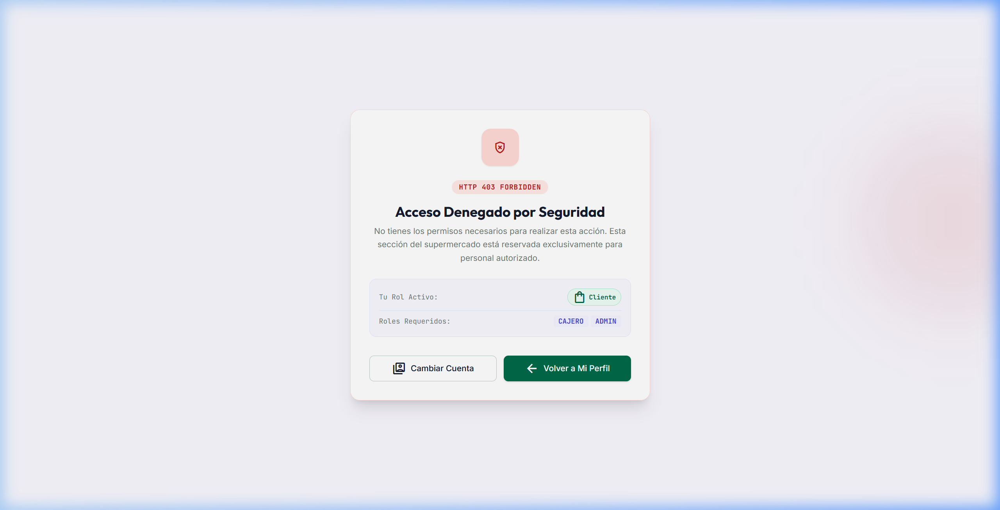
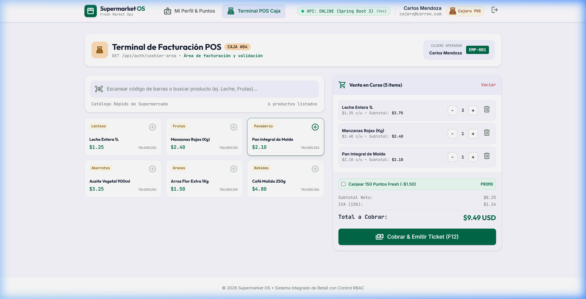
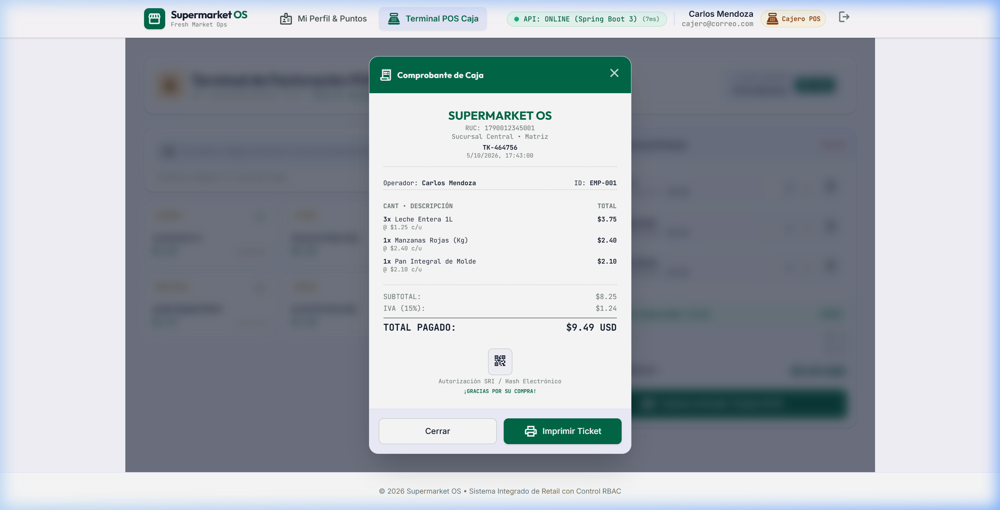
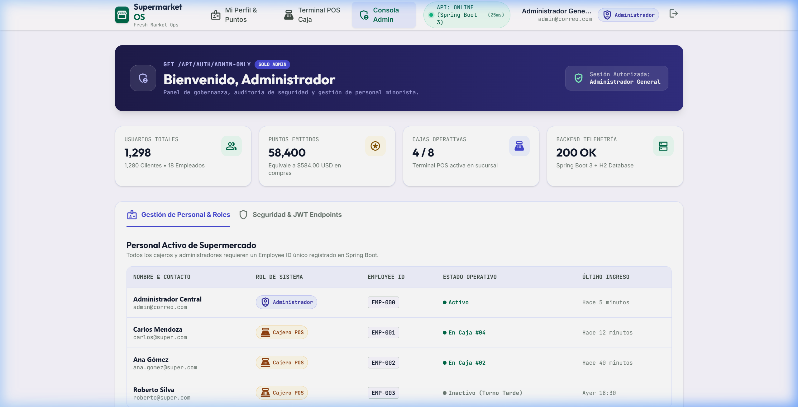
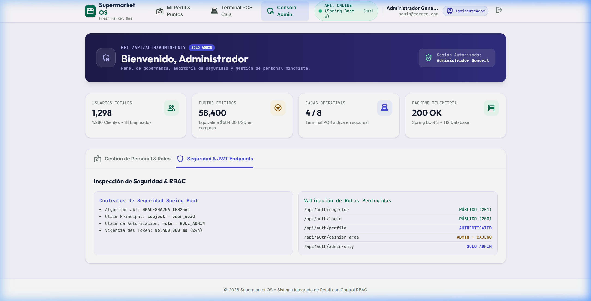

# 🛒 Supermarket OS — Fresh Market Operations & Loyalty Suite

> **Monorepo Full-Stack para Ingeniería Web**  
> **Backend**: Java 17 + Spring Boot 3.3.4 + Spring Security + JWT + H2/JPA  
> **Frontend**: React 19 + Vite 8 + Tailwind CSS v4 + React Router v7 + Lucide Icons  
> **Repositorio Oficial**: [https://github.com/J7pultra/SupermarketFrontendBackend.git](https://github.com/J7pultra/SupermarketFrontendBackend.git)

---

## 📋 Resumen del Proyecto

**Supermarket OS** es una solución integral diseñada para modernizar las operaciones de punto de venta (POS), la gestión administrativa del personal y la fidelización de clientes de una cadena de supermercados.

El sistema fue diseñado e implementado conectando un backend robusto en **Spring Boot** con un frontend modular y reactivo en **React + Tailwind CSS v4**, siguiendo lineamientos de diseño de vanguardia (**Google Stitch / Fresh Emerald Theme**) y aplicando **Role-Based Access Control (RBAC)** estricto garantizado por tokens JWT criptográficos.

---

## 🔑 Credenciales Demo Pre-inicializadas

El backend incluye un componente automático (`DataInitializer.java`) que limpia y siembra las siguientes cuentas maestras al iniciar la aplicación. Puede iniciar sesión manualmente con ellas o usar los botones de **1-Click** en la barra superior de la pantalla de login:

| Rol | Correo Electrónico | Contraseña | ID Empleado | Funcionalidades Principales |
| :--- | :--- | :--- | :--- | :--- |
| **👑 ADMINISTRADOR** | `admin@correo.com` | `Password123` | `EMP-001` | Dashboard ejecutivo, métricas KPI, gestión de empleados y auditoría de tokens JWT/RBAC. |
| **💳 CAJERO** | `cajero@correo.com` | `Password123` | `EMP-002` | Terminal Punto de Venta (POS), carrito interactivo, cálculo de IVA (15%) y emisión de facturas electrónicas SRI con QR. |
| **🌟 CLIENTE** | `cliente@correo.com` | `Password123` | *N/A* | Fresh Rewards Club, 1,450 puntos de lealtad, estatus Gold, tarjeta digital con QR y control estricto de acceso (403 si intenta entrar a áreas de staff). |

---

## 🚀 Guía de Instalación y Ejecución Local

Para probar el proyecto completo en su máquina local, siga estos sencillos pasos:

### 1. Requisitos Previos
* **Java Development Kit (JDK)**: Versión 17 o superior.
* **Node.js**: Versión 18 o superior (con `npm`).
* **Git**: Para clonar el repositorio.

---

### 2. Arrancar el Backend (Spring Boot API)
El backend corre en el puerto **`3000`** para sincronizarse directamente con el proxy y configuración del frontend.

```powershell
# 1. Navegar a la carpeta del backend
cd SupermarketApi

# 2. Ejecutar con el Maven Wrapper integrado (no requiere tener Maven instalado globalmente)
# En Windows:
.\mvnw.cmd spring-boot:run

# En Linux / macOS:
./mvnw spring-boot:run
```
> ✅ **Confirmación**: La consola mostrará:  
> `Tomcat started on port 3000 (http) with context path '/'`  
> `[DataInitializer] Sembrando cuentas por defecto listas para evaluación...`

---

### 3. Arrancar el Frontend (React + Vite)
El frontend corre en el puerto **`5173`**.

```powershell
# 1. Abrir otra terminal y navegar a la carpeta del frontend
cd frontend-app-ing-web

# 2. Instalar dependencias
npm install

# 3. Iniciar el servidor de desarrollo
npm run dev
```
> ✅ **Listo**: Abra su navegador en **[http://localhost:5173](http://localhost:5173)**.  
> Notará una insignia verde **"API: ONLINE (3000)"** que confirma la comunicación fluida entre ambos sistemas.

---

## 📁 Documentación de Arquitectura y Diseño

El proyecto cuenta con documentación técnica exhaustiva ubicada en la raíz del repositorio:

* 🎨 **[SISTEMA_DE_DISENO_SUPERMARKET_API.md](./SISTEMA_DE_DISENO_SUPERMARKET_API.md)**: Manual completo de diseño UI/UX (Fresh Market Emerald, tipografía Inter/Outfit, tokens de color, componentes atómicos, estados de interacción y accesibilidad WCAG AA).
* 🗺️ **[PLAN_INTEGRACION_STITCH_FRONTEND.md](./PLAN_INTEGRACION_STITCH_FRONTEND.md)**: Plan de desarrollo por fases, mapa de endpoints, contratos de interfaz REST y matriz de permisos por rol.
* 📊 **[ESTADO_DEL_PROYECTO.md](./ESTADO_DEL_PROYECTO.md)**: Registro de control de cambios, hitos completados y cobertura de pruebas.

---

## 📸 Evidencias de Funcionamiento (Capturas del Sistema)

A continuación se presentan las capturas de pantalla tomadas directamente sobre el navegador interactuando con el sistema en tiempo real:

### 1. Pantalla de Inicio de Sesión (Login)
*Monitoreo en tiempo real del estado de la API, diseño con glassmorphism, selector rápido de credenciales demo e integración JWT.*


---

### 2. Registro de Usuarios Multi-Rol
*Formulario con selección visual de rol (Cliente, Cajero, Admin) y validación condicional dinámica del campo "Código de Empleado" requerida por el backend para roles de personal.*


---

### 3. Portal de Fidelización del Cliente (Fresh Rewards)
*Vista exclusiva para el rol `CLIENTE`. Exhibe el saldo de 1,450 Fresh Points, nivel Gold Member, beneficios activos, tarjeta virtual con código QR para canje en caja y catálogo de recompensas.*


---

### 4. Seguridad Perimetral y Control RBAC (403 Forbidden)
*Prueba de seguridad: Cuando el usuario con sesión activa de `CLIENTE` intenta navegar a `/pos` o `/admin`, el router inteligente lo intercepta inmediatamente y despliega la pantalla de acceso denegado con opción de retorno seguro.*


---

### 5. Terminal Punto de Venta (POS) del Cajero
*Terminal táctil de alta velocidad para el `CAJERO`. Incluye catálogo de abarrotes con filtros de categoría, selector de cantidades, canasta de compras en tiempo real, cálculo de subtotal y desglose fiscal del 15% de IVA.*


---

### 6. Emisión de Factura Electrónica con Código QR
*Modal interactivo que se genera al procesar la venta en caja. Presenta número de comprobante, desglose de ítems, totales, método de pago, código QR fiscal del SRI y botón de impresión directa.*


---

### 7. Consola Administrativa — Panel de Métricas
*Vista para el rol `ADMINISTRADOR`. Muestra KPIs clave del negocio (Ventas del día, Clientes registrados, Cajeros activos, Turnos abiertos), tabla de colaboradores del supermercado con sus turnos e IDs de empleado.*


---

### 8. Consola Administrativa — Auditoría de Seguridad & JWT
*Herramienta de diagnóstico para administradores. Decodifica el token JWT actual, verifica emisor, algoritmo HMAC-SHA256, expiración y enumera los permisos RBAC aplicados en cada endpoint de la API.*


---

## 🏛️ Estructura del Monorepo

```text
├── SupermarketApi/                          # Backend Spring Boot 3
│   ├── src/main/java/com/supermarket/api/
│   │   ├── config/                          # DataInitializer.java (Seeding de usuarios) & SecurityConfig
│   │   ├── controller/                      # AuthController, etc.
│   │   ├── dto/                             # AuthResponse, LoginRequest, RegisterRequest
│   │   ├── model/                           # User, Role enum (ADMIN, CAJERO, CLIENTE)
│   │   ├── repository/                      # UserRepository
│   │   ├── security/                        # JwtTokenProvider, CustomUserDetailsService
│   │   └── service/                         # AuthService, UserService
│   ├── src/main/resources/application.properties
│   ├── pom.xml
│   └── mvnw.cmd / mvnw
│
├── frontend-app-ing-web/                    # Frontend React 19 + Vite
│   ├── src/
│   │   ├── components/
│   │   │   ├── auth/                        # DemoCredentialsBar, ProtectedRoute
│   │   │   └── layout/                      # Navbar, Footer
│   │   ├── context/                         # AuthContext.jsx (Estado global y persistencia JWT)
│   │   ├── pages/                           # LoginPage, RegisterPage, CashierPOSPage, 
│   │   │                                    # AdminDashboardPage, ClientProfilePage, Forbidden403Page
│   │   ├── services/                        # api.js (Axios con interceptores de Bearer token)
│   │   ├── index.css                        # Tailwind CSS v4 con tokens de diseño Stitch
│   │   └── App.jsx
│   ├── package.json
│   └── vite.config.js
│
├── docs/
│   └── screenshots/                         # Capturas de alta definición del sistema
├── SISTEMA_DE_DISENO_SUPERMARKET_API.md      # Especificación completa de UI/UX
├── PLAN_INTEGRACION_STITCH_FRONTEND.md       # Arquitectura de integración y contratos
├── ESTADO_DEL_PROYECTO.md                   # Resumen ejecutivo de avance
├── .gitignore                               # Exclusiones de Git (node_modules, target, etc.)
└── README.md                                # Este documento
```

---

## 👥 Desarrolladores y Contacto
* **Asignatura**: Ingeniería Web
* **Repositorio GitHub**: [J7pultra/SupermarketFrontendBackend](https://github.com/J7pultra/SupermarketFrontendBackend.git)
