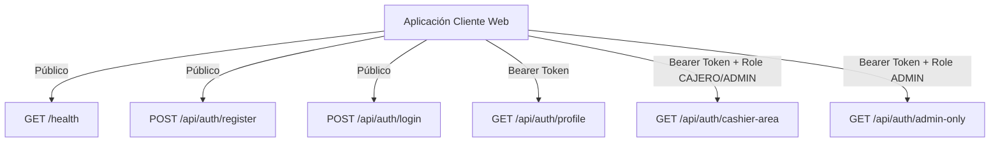
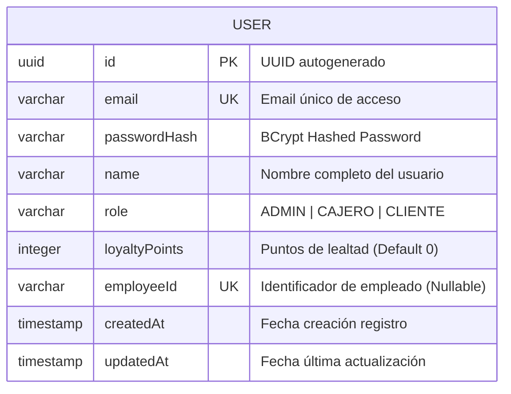
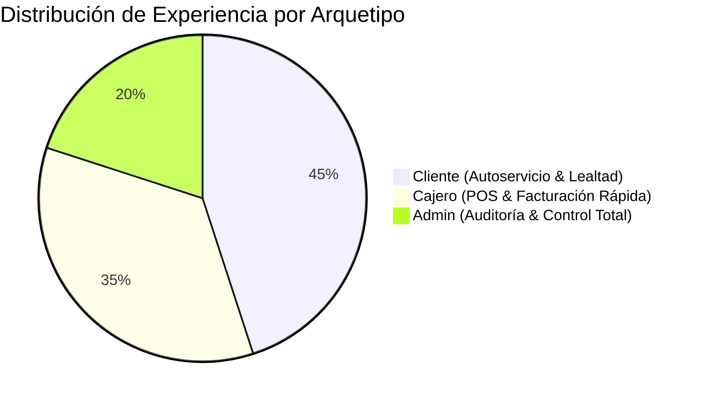
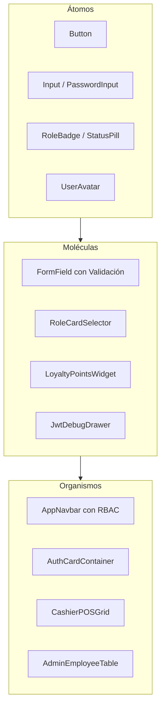

# 🛒 Sistema de Diseño: Supermarket App (SDS)
### Arquitectura Visual, Tokens, Componentes y Flujos de Usuario basados en `SupermarketApi`

> **Documento Técnico & Guía de Diseño de Interfaz**  
> **Proyecto:** Supermarket API (Spring Boot 3 + Java 17 + PostgreSQL / H2 + JWT)  
> **Aplicación Cliente:** Frontend Web (React 19 + Vite + Axios)  
> **Versión del Sistema de Diseño:** 1.0.0  
> **Autor:** Antigravity AI Architecture Team  
> **Fecha:** Octubre 2026  

---

## 📑 Tabla de Contenidos
1. [Análisis Integral del Backend (`SupermarketApi`)](#1-análisis-integral-del-backend-supermarketapi)
   - [1.1 Stack Tecnológico & Configuración](#11-stack-tecnológico--configuración)
   - [1.2 Catálogo y Matriz Completa de Endpoints](#12-catálogo-y-matriz-completa-de-endpoints)
   - [1.3 Modelo de Datos y Entidades de Dominio](#13-modelo-de-datos-y-entidades-de-dominio)
   - [1.4 Mecanismo de Seguridad y Ciclo de Vida del JWT](#14-mecanismo-de-seguridad-y-ciclo-de-vida-del-jwt)
   - [1.5 Contrato Estándar de Respuestas y Errores](#15-contrato-estándar-de-respuestas-y-errores)
2. [Filosofía y Fundamentos de Diseño](#2-filosofía-y-fundamentos-de-diseño)
   - [2.1 Propósito y Arquetipos de Usuario (RBAC)](#21-propósito-y-arquetipos-de-usuario-rbac)
   - [2.2 Principios Rectores](#22-principios-rectores)
3. [Design Tokens (Tokens de Diseño)](#3-design-tokens-tokens-de-diseño)
   - [3.1 Paleta Cromática Semántica y de Roles](#31-paleta-cromática-semántica-y-de-roles)
   - [3.2 Colores de Códigos de Estado HTTP](#32-colores-de-códigos-de-estado-http)
   - [3.3 Tipografía y Jerarquía](#33-tipografía-y-jerarquía)
   - [3.4 Espaciado, Grilla y Layout](#34-espaciado-grilla-y-layout)
   - [3.5 Radios de Borde y Elevaciones (Sombras)](#35-radios-de-borde-y-elevaciones-sombras)
   - [3.6 Transiciones y Microinteracciones](#36-transiciones-y-microinteracciones)
4. [Arquitectura de Vistas & Flujos de Usuario según Endpoints](#4-arquitectura-de-vistas--flujos-de-usuario-según-endpoints)
   - [4.1 Mapeo de Rutas Frontend vs Endpoints API](#41-mapeo-de-rutas-frontend-vs-endpoints-api)
   - [4.2 Flujo 1: Conectividad y Salud del Servidor (`/health`)](#42-flujo-1-conectividad-y-salud-del-servidor-health)
   - [4.3 Flujo 2: Autenticación y Acceso (`/api/auth/login`)](#43-flujo-2-autenticación-y-acceso-apiauthlogin)
   - [4.4 Flujo 3: Registro Inteligente Multirrol (`/api/auth/register`)](#44-flujo-3-registro-inteligente-multirrol-apiauthregister)
   - [4.5 Flujo 4: Perfil de Usuario y Fidelización (`/api/auth/profile`)](#45-flujo-4-perfil-de-usuario-y-fidelización-apiauthprofile)
   - [4.6 Flujo 5: Terminal de Facturación de Cajero (`/api/auth/cashier-area`)](#46-flujo-5-terminal-de-facturación-de-cajero-apiauthcashier-area)
   - [4.7 Flujo 6: Consola de Mando de Administrador (`/api/auth/admin-only`)](#47-flujo-6-consola-de-mando-de-administrador-apiauthadmin-only)
   - [4.8 Flujos de Excepción: Estados 401 y 403](#48-flujos-de-excepción-estados-401-y-403)
5. [Biblioteca de Componentes UI (Atomic Design)](#5-biblioteca-de-componentes-ui-atomic-design)
   - [5.1 Átomos](#51-átomos)
   - [5.2 Moléculas](#52-moléculas)
   - [5.3 Organismos](#53-organismos)
6. [Implementación Técnica de Código (Tokens CSS & Componentes React)](#6-implementación-técnica-de-código-tokens-css--componentes-react)
   - [6.1 Archivo `tokens.css` (Variables CSS Puramente Nativas)](#61-archivo-tokenscss-variables-css-puramente-nativas)
   - [6.2 Interceptor de Axios para Bearer Token y Manejo de Errores](#62-interceptor-de-axios-para-bearer-token-y-manejo-de-errores)
   - [6.3 Componente `RoleBadge.jsx`](#63-componente-rolebadgejsx)
   - [6.4 Componente `PasswordInput.jsx` con Validador Dinámico](#64-componente-passwordinputjsx-con-validador-dinámico)
   - [6.5 Componente `EmployeeIdField.jsx` (Lógica Condicional de Rol)](#65-componente-employeeidfieldjsx-lógica-condicional-de-rol)
   - [6.6 Componente `ApiHealthPill.jsx`](#66-componente-apihealthpilljsx)
7. [Roadmap y Extensibilidad del Dominio Supermercado](#7-roadmap-y-extensibilidad-del-dominio-supermercado)

---

## 1. Análisis Integral del Backend (`SupermarketApi`)

El proyecto **`SupermarketApi`** es una API RESTful desarrollada con **Spring Boot 3.2.5** y **Java 17**. Su diseño sigue una arquitectura por capas desacoplada y orientada a la seguridad, implementando un esquema de **Role-Based Access Control (RBAC)** con tokens criptográficos JWT y persistencia dual (base de datos en memoria **H2** para desarrollo inmediato y **PostgreSQL 15** mediante Docker para entornos de producción).

### 1.1 Stack Tecnológico & Configuración

| Parámetro | Valor / Tecnología | Observación |
| :--- | :--- | :--- |
| **Lenguaje** | Java 17 (OpenJDK / Eclipse Temurin) | Uso de Records, switch expressions y lambdas |
| **Framework Base** | Spring Boot 3.2.5 | `spring-boot-starter-web`, `validation`, `security`, `data-jpa` |
| **CORS** | `*` (Orígenes, Cabeceras y Métodos permitidos) | Configurado en `SecurityConfig.java` para consumo desacoplado |
| **Puerto del Servidor** | `3000` (`server.port=3000`) | Configurado en `application.properties` |
| **Base de Datos Local** | H2 Database (`jdbc:h2:mem:supermercado_db`) | Consola web habilitada en `/h2-console` |
| **Base de Datos Producción** | PostgreSQL 15 Alpine (`supermercado_db`) | Orquestado vía `docker-compose.yml` en puerto 5432 |
| **Manejo de Contraseñas** | BCrypt (`BCryptPasswordEncoder`) | Hash unidireccional seguro |
| **Librería JWT** | `io.jsonwebtoken` (JJWT 0.12.5) | Firma HMAC-SHA256 con algoritmo HS256 |
| **Vencimiento de Token** | 24 Horas (`86400000 ms`) en dev / 8h en Docker | Clave de seguridad configurada en `jwt.secret` |

---

### 1.2 Catálogo y Matriz Completa de Endpoints



A continuación se detalla el comportamiento exacto de cada uno de los endpoints registrados en el backend:

#### 1. `GET /health`
- **Controlador:** `HealthController.java`
- **Nivel de Acceso:** Público (sin autenticación).
- **Finalidad:** Comprobación de estado operativo del servidor (Liveness / Readiness Probe).
- **Respuesta Exitosa (`200 OK`):**
  ```json
  {
    "status": "OK",
    "message": "API funcionando correctamente"
  }
  ```

#### 2. `POST /api/auth/register`
- **Controlador:** `AuthController.java` -> `AuthServiceImpl.java`
- **Nivel de Acceso:** Público.
- **Payload Requerido (`RegisterRequest`):**
  ```json
  {
    "name": "Carlos Mendoza",
    "email": "carlos@supermercado.com",
    "password": "Password123",
    "role": "CLIENTE",
    "employeeId": null
  }
  ```
- **Reglas de Negocio y Validaciones de Entrada:**
  1. `name`: Obligatorio, mínimo 2 caracteres.
  2. `email`: Obligatorio, formato de correo válido y único en la base de datos (lanza `400 Bad Request` si ya existe).
  3. `password`: Mínimo 8 caracteres, al menos 1 letra mayúscula y al menos 1 número (`Pattern: .*?[A-Z].*` y `.*?[0-9].*`).
  4. `role`: Opcional en el JSON (toma `CLIENTE` por defecto). Valores aceptados: `"CLIENTE"`, `"CAJERO"`, `"ADMIN"`.
  5. `employeeId`: **Obligatorio** si `role` es `"CAJERO"` o `"ADMIN"`. Si se proporciona, debe ser único en la base de datos (lanza `400 Bad Request` si ya existe). Para `"CLIENTE"`, se guarda como `null`.
- **Respuesta Exitosa (`201 Created`):**
  ```json
  {
    "status": "success",
    "message": "Usuario registrado exitosamente",
    "data": {
      "id": "c1f10bc4-8b65-4a6c-9c71-0810db61a7a0",
      "email": "carlos@supermercado.com",
      "name": "Carlos Mendoza",
      "role": "CLIENTE",
      "loyaltyPoints": 0,
      "employeeId": null,
      "createdAt": "2026-10-05T16:20:00",
      "updatedAt": "2026-10-05T16:20:00"
    }
  }
  ```

#### 3. `POST /api/auth/login`
- **Controlador:** `AuthController.java` -> `AuthServiceImpl.java`
- **Nivel de Acceso:** Público.
- **Payload Requerido (`LoginRequest`):**
  ```json
  {
    "email": "admin@correo.com",
    "password": "AdminPassword123"
  }
  ```
- **Comportamiento:** Compara el hash con BCrypt. Si falla el email o la contraseña, devuelve `401 Unauthorized` con mensaje `"Credenciales inválidas"`.
- **Respuesta Exitosa (`200 OK`):**
  ```json
  {
    "status": "success",
    "message": "Autenticación exitosa",
    "data": {
      "token": "eyJhbGciOiJIUzI1NiIsInR5cCI6IkpXVCJ9.eyJzdWIiOiJjMWYxMGJjNC04YjY1LTRhNmMtOWM3MS0wODEwZGI2MWE3YTAiLCJyb2xlIjoiUk9MRV9BRE1JTiIsImlhdCI6MTY5NjUyNjgwMCwiZXhwIjoxNjk2NjEzMjAwfQ...",
      "user": {
        "id": "c1f10bc4-8b65-4a6c-9c71-0810db61a7a0",
        "email": "admin@correo.com",
        "name": "Administrador Principal",
        "role": "ADMIN"
      }
    }
  }
  ```

#### 4. `GET /api/auth/profile`
- **Controlador:** `AuthController.java`
- **Nivel de Acceso:** Requiere cabecera `Authorization: Bearer <token>` (Cualquier usuario autenticado).
- **Respuesta Exitosa (`200 OK`):**
  ```json
  {
    "message": "Perfil de usuario",
    "user": {
      "userId": "c1f10bc4-8b65-4a6c-9c71-0810db61a7a0",
      "role": "ADMIN"
    }
  }
  ```

#### 5. `GET /api/auth/cashier-area`
- **Controlador:** `AuthController.java`
- **Nivel de Acceso:** Protegido con Spring Security (`hasAnyRole("ADMIN", "CAJERO")`).
- **Respuesta Exitosa (`200 OK`):**
  ```json
  {
    "message": "Área de facturación y validación"
  }
  ```

#### 6. `GET /api/auth/admin-only`
- **Controlador:** `AuthController.java`
- **Nivel de Acceso:** Protegido con Spring Security (`hasRole("ADMIN")`).
- **Respuesta Exitosa (`200 OK`):**
  ```json
  {
    "message": "Bienvenido, Administrador"
  }
  ```

---

### 1.3 Modelo de Datos y Entidades de Dominio

La entidad JPA central es `User` (`com.supermarket.api.entity.User`), mapeada a la tabla `users`:



#### Atributos y su Impacto en la UI:
1. **`id` (`UUID`)**: Identificador único global. En la interfaz se muestra truncado o con formato `UUID-copyable` con microinteracción de copiado.
2. **`email`**: Utilizado como credencial de acceso principal. Requiere input con autocompletado y validación de sintaxis en tiempo real.
3. **`role` (`Role.java`)**: Enum con 3 valores:
   - `CLIENTE`: Usuario final comprador. Acumula `loyaltyPoints`. No posee `employeeId`.
   - `CAJERO`: Empleado de caja registradora. Posee `employeeId`. Acceso a facturación y validación (`/cashier-area`).
   - `ADMIN`: Gerente o Administrador de sistemas. Posee `employeeId`. Acceso total al sistema (`/admin-only` y `/cashier-area`).
4. **`loyaltyPoints`**: Puntos de fidelidad acumulados por las compras en el supermercado. La interfaz debe mostrar un componente de gamificación o tarjeta de lealtad (barra de nivel, puntos canjeables).
5. **`employeeId`**: Código de empleado interno (ej. `EMP-042`). Solo relevante para personal del supermercado. En la UI de registro debe desplegarse condicionalmente mediante una animación suave al seleccionar `CAJERO` o `ADMIN`.

---

### 1.4 Mecanismo de Seguridad y Ciclo de Vida del JWT

1. **Generación**: Al iniciar sesión (`POST /api/auth/login`), `JwtService` emite un token con:
   - `Subject`: ID del usuario (`UUID.toString()`).
   - `Claim "role"`: `"ROLE_" + user.getRole().name()` (ej. `ROLE_ADMIN`).
   - `IssuedAt` & `Expiration`.
2. **Filtro de Peticiones (`JwtAuthenticationFilter`)**: Intercepta cada solicitud entrante, extrae el Bearer token, valida la firma criptográfica y establece el contexto de seguridad en `SecurityContextHolder`.
3. **Manejo de Errores de Seguridad (`SecurityConfig`)**:
   - `AuthenticationEntryPoint` (`401 Unauthorized`): Si el token no existe, está alterado o expiró.
   - `AccessDeniedHandler` (`403 Forbidden`): Si el usuario autenticado intenta ingresar a un recurso para el cual su rol no tiene privilegios.

---

### 1.5 Contrato Estándar de Respuestas y Errores

Tanto las respuestas de éxito como los fallos capturados por `GlobalExceptionHandler` siguen la estructura unificada de la clase `ApiResponse<T>`:

```json
// Estructura Genérica
{
  "status": "success | error",
  "message": "Descripción clara del resultado",
  "data": { ... } // Solo presente en respuestas exitosas con payload
}
```

#### Catálogo de Errores HTTP:
| Código HTTP | Causa en el Backend | Formato JSON devuelto |
| :--- | :--- | :--- |
| **`400 Bad Request`** | Error en validación de campos (`@Valid`), email ya registrado o falta `employeeId`. | `{"status":"error", "message":"El email ya está registrado"}` |
| **`401 Unauthorized`** | Credenciales incorrectas en login, o token faltante/expirado. | `{"status":"error", "message":"Credenciales inválidas"}` o `{"status":"error", "message":"Token inválido o expirado"}` |
| **`403 Forbidden`** | Rol insuficiente para la ruta solicitada. | `{"status":"error", "message":"No tienes los permisos necesarios para realizar esta acción"}` |
| **`404 Not Found`** | Recurso o ruta no encontrada. | `{"status":"error", "message":"Recurso no encontrado"}` |
| **`500 Internal Error`**| Error no controlado en la lógica del servidor. | `{"status":"error", "message":"Error interno del servidor"}` |

---

## 2. Filosofía y Fundamentos de Diseño

El Sistema de Diseño **Supermarket Design System (SDS)** está concebido para unificar la experiencia de compra de los clientes y la eficiencia operativa de los empleados del supermercado.

### 2.1 Propósito y Arquetipos de Usuario (RBAC)



1. **Arquetipo CLIENTE (Shopper / Consumidor Final)**:
   - **Enfoque UX:** Calidez, claridad de precios, consulta rápida de saldo y puntos de lealtad (`loyaltyPoints`), simplicidad en el registro.
   - **Tono Visual:** Fresco, amigable, con toques verdes orgánicos y tarjetas de lealtad destacadas.
2. **Arquetipo CAJERO (Punto de Venta / Terminal de Caja)**:
   - **Enfoque UX:** Alta velocidad, alto contraste visual, tipografía monoespaciada para códigos y montos, atajos de teclado, botones táctiles grandes para pantallas de POS.
   - **Tono Visual:** Enérgico, enfocado en estado de caja, alertas claras de cobro y validación de identidad.
3. **Arquetipo ADMINISTRADOR (Gestión & Gobernanza)**:
   - **Enfoque UX:** Densidad de datos equilibrada, métricas ejecutivas, control de empleados y perfiles, visualización de logs de seguridad y estado de los servicios.
   - **Tono Visual:** Sobrio, índigo/púrpura profundo, tarjetas analíticas y badges de autorización.

### 2.2 Principios Rectores
1. **Claridad Operativa Inmediata:** Los estados del sistema (servidor online/offline, rol activo, autenticado o denegado) deben ser comprensibles en menos de 200 ms.
2. **Feedback No Obstructivo:** Los errores de la API (`400`, `401`, `403`) deben comunicarse en el contexto exacto donde ocurren (inline en inputs o banners superiores no intrusivos), sin interrumpir la labor del cajero o la compra del cliente.
3. **Accesibilidad Universal (WCAG 2.1 Nivel AA):** Contrastes mínimos de 4.5:1 para texto normal y soporte total para navegación por teclado en formularios y botones de acción.
4. **Resiliencia de Conectividad:** La aplicación debe informar al usuario si la API (`/health`) experimenta latencia o caída antes de que el usuario envíe una transacción.

---

## 3. Design Tokens (Tokens de Diseño)

Los tokens representan las decisiones fundamentales de diseño expresadas como variables reutilizables.

### 3.1 Paleta Cromática Semántica y de Roles

#### 🟢 Brand Principal: *Fresh Emerald & Supermarket Mint*
- `--color-brand-primary`: `#10B981` (Esmeralda fresco, evoca productos frescos, salud y confianza)
- `--color-brand-primary-hover`: `#059669`
- `--color-brand-primary-subtle`: `rgba(16, 185, 129, 0.12)`
- `--color-brand-dark`: `#064E3B`

#### 🏷️ Colores Específicos por Rol de Usuario (RBAC)
Cada rol posee una identidad cromática única en badges, avatares y barras laterales para evitar confusiones de privilegios:

| Rol de Usuario | Color Primario | Color Fondo / Subtle | Uso en Interfaz |
| :--- | :--- | :--- | :--- |
| **CLIENTE** | `#10B981` (Verde Esmeralda) | `rgba(16, 185, 129, 0.12)` | Badge de Cliente, Widget de Puntos, Tarjeta de Fidelidad |
| **CAJERO** | `#F59E0B` (Ámbar Dorado) | `rgba(245, 158, 11, 0.14)` | Terminal POS, Botón de Cobro, Badge de Empleado de Caja |
| **ADMIN** | `#6366F1` (Índigo Royal) | `rgba(99, 102, 241, 0.14)` | Panel Maestro, Badge Admin, Acciones de Auditoría |

#### 🌓 Modos Claro y Oscuro (Neutros & Superficies)

```
        MODO CLARO (Day Market)                    MODO OSCURO (Night Hub)
┌──────────────────────────────────────┐   ┌──────────────────────────────────────┐
│ Superficie: #F8FAFC (Slate 50)       │   │ Superficie: #0F172A (Slate 900)      │
│ Tarjetas:   #FFFFFF (Blanco puro)    │   │ Tarjetas:   #1E293B (Slate 800)      │
│ Bordes:     #E2E8F0 (Slate 200)      │   │ Bordes:     #334155 (Slate 700)      │
│ Texto Ppal: #0F172A (Slate 900)      │   │ Texto Ppal: #F8FAFC (Slate 50)       │
│ Texto Sec:  #64748B (Slate 500)      │   │ Texto Sec:  #94A3B8 (Slate 400)      │
└──────────────────────────────────────┘   └──────────────────────────────────────┘
```

---

### 3.2 Colores de Códigos de Estado HTTP

Diseñados específicamente para representar visualmente las respuestas de la API REST:

| Código HTTP | Nombre Semántico | Hex | Token CSS | Aplicación en la UI |
| :--- | :--- | :--- | :--- | :--- |
| **`200 / 201`** | Éxito / Creado | `#10B981` | `--color-status-success` | Registro exitoso, Login completado, Health OK |
| **`400`** | Error de Validación | `#F43F5E` | `--color-status-bad-request` | Email duplicado, contraseña sin mayúscula/número |
| **`401`** | No Autorizado | `#F59E0B` | `--color-status-unauthorized`| Credenciales erróneas, token expirado |
| **`403`** | Acceso Prohibido | `#EF4444` | `--color-status-forbidden` | Cliente intentando entrar a `/admin-only` |
| **`500`** | Error del Servidor | `#881337` | `--color-status-server-error`| Caída de conexión con Postgres o excepción 500 |

---

### 3.3 Tipografía y Jerarquía

- **Fuente Sans-Serif Principal:** `'Inter', -apple-system, BlinkMacSystemFont, 'Segoe UI', Roboto, sans-serif`
  - Utilizada para títulos, textos, botones, navegación e inputs.
- **Fuente Display:** `'Outfit', sans-serif`
  - Para títulos principales y métricas del Dashboard de Supermercado.
- **Fuente Monoespaciada:** `'JetBrains Mono', 'Consolas', monospace`
  - Imprescindible para: `id` (UUID), `employeeId` (ej. `EMP-001`), saldo de `loyaltyPoints`, tokens JWT y respuestas de depuración de endpoints.

#### Escala Tipográfica:
- `text-xs`: `0.75rem` (12px) - Line-height: `1rem` (Labels auxiliares, badges de rol)
- `text-sm`: `0.875rem` (14px) - Line-height: `1.25rem` (Inputs, textos de ayuda, tablas)
- `text-base`: `1rem` (16px) - Line-height: `1.5rem` (Texto de lectura general, botones)
- `text-lg`: `1.125rem` (18px) - Line-height: `1.75rem` (Subtítulos, tarjetas de producto)
- `text-xl`: `1.25rem` (20px) - Line-height: `1.75rem` (Títulos de tarjetas y modales)
- `text-2xl`: `1.5rem` (24px) - Line-height: `2rem` (Encabezados de sección)
- `text-3xl`: `1.875rem` (30px) - Line-height: `2.25rem` (Títulos principales de módulo)
- `text-4xl`: `2.25rem` (36px) - Line-height: `2.5rem` (Contadores de puntos y KPIs)

---

### 3.4 Espaciado, Grilla y Layout

Basado en la regla de múltiplos de 4 y 8 píxeles:
- `--spacing-1`: `4px`
- `--spacing-2`: `8px`
- `--spacing-3`: `12px`
- `--spacing-4`: `16px`
- `--spacing-6`: `24px`
- `--spacing-8`: `32px`
- `--spacing-12`: `48px`
- `--spacing-16`: `64px`

**Contenedores de Layout:**
- Formulario de Auth (Login / Register): Ancho máximo centrado de `460px`.
- Panel de POS de Cajero: Grilla interactiva a pantalla completa `100vw - 280px` (Sidebar colapsable).
- Dashboard de Administrador: Contenedor con ancho máximo de `1280px` con gutters de `24px`.

---

### 3.5 Radios de Borde y Elevaciones (Sombras)

#### Radios de Borde:
- `--radius-sm`: `4px` (Badges pequeños y tooltips)
- `--radius-md`: `8px` (Inputs, botones de acción)
- `--radius-lg`: `12px` (Tarjetas de producto, contenedores de formulario)
- `--radius-xl`: `16px` (Modales de diálogo, tarjetas de lealtad)
- `--radius-full`: `9999px` (Píldoras de estado, avatares circulares)

#### Elevaciones (Box-Shadows):
- `--shadow-sm`: `0 1px 2px 0 rgba(0, 0, 0, 0.05)`
- `--shadow-md`: `0 4px 6px -1px rgba(0, 0, 0, 0.08), 0 2px 4px -1px rgba(0, 0, 0, 0.04)`
- `--shadow-lg`: `0 10px 15px -3px rgba(0, 0, 0, 0.1), 0 4px 6px -2px rgba(0, 0, 0, 0.05)`
- `--shadow-role-cliente`: `0 0 16px -2px rgba(16, 185, 129, 0.3)`
- `--shadow-role-cajero`: `0 0 16px -2px rgba(245, 158, 11, 0.3)`
- `--shadow-role-admin`: `0 0 16px -2px rgba(99, 102, 241, 0.3)`

---

### 3.6 Transiciones y Microinteracciones
- `--transition-fast`: `150ms cubic-bezier(0.4, 0, 0.2, 1)` (Hover de botones e inputs)
- `--transition-normal`: `250ms cubic-bezier(0.4, 0, 0.2, 1)` (Apertura de desplegables, toggles)
- `--transition-bounce`: `350ms cubic-bezier(0.34, 1.56, 0.64, 1)` (Aparición de badges y modal)

---

## 4. Arquitectura de Vistas & Flujos de Usuario según Endpoints

### 4.1 Mapeo de Rutas Frontend vs Endpoints API

| Ruta Frontend | Componente / Vista | Endpoint(s) Vinculado(s) | Roles con Acceso |
| :--- | :--- | :--- | :--- |
| `/*` (Global Navbar) | `ServerHealthIndicator` | `GET /health` | Público |
| `/login` | `LoginPage` | `POST /api/auth/login` | Público (Redirige si ya está autenticado) |
| `/register` | `RegisterPage` | `POST /api/auth/register` | Público |
| `/profile` | `UserProfileModal` / `ProfileView` | `GET /api/auth/profile` | Autenticado (`CLIENTE`, `CAJERO`, `ADMIN`) |
| `/pos` o `/cashier` | `CashierWorkstation` | `GET /api/auth/cashier-area` | `CAJERO` y `ADMIN` |
| `/admin` | `AdminControlCenter` | `GET /api/auth/admin-only` | Exclusivo `ADMIN` |
| `/403` | `ForbiddenAccessPage` | Interceptor de `403` | Autenticado con rol no permitido |

---

### 4.2 Flujo 1: Conectividad y Salud del Servidor (`/health`)

#### Propósito:
Ofrecer visibilidad en tiempo real sobre la disponibilidad del servicio.

```
+-----------------------------------------------------------+
| 🛒 SUPERMARKET OS         [🟢 API Online | Latencia 32ms] |
+-----------------------------------------------------------+
```

- **Comportamiento en UI:**
  - Al montar la aplicación cliente, se ejecuta `GET /health`.
  - Si la respuesta es `{ "status": "OK" }`, se muestra una píldora verde `API Online`.
  - Si la petición falla o entra en timeout (`> 3000ms`), la píldora se transforma en ámbar/roja con el texto `API Desconectada (Modo Offline)`, deshabilitando transacciones críticas y advirtiendo al usuario.

---

### 4.3 Flujo 2: Autenticación y Acceso (`/api/auth/login`)

#### Wireframe y Disposición Visual:
```
+---------------------------------------------------------+
|                  🛒 SUPERMARKET OS                      |
|                  Iniciar Sesión                         |
|                                                         |
|  [ Correo Electrónico                                 ] |
|  [ •••••••••••••••••                                👁 ] |
|                                                         |
|  [              INICIAR SESIÓN (Botón)                ] |
|                                                         |
|  ¿Nuevo usuario? Crear cuenta en Supermarket            |
+---------------------------------------------------------+
```

#### Estados del Formulario:
1. **Idle / Listo:** Botón habilitado, campos limpios.
2. **Submitting:** Botón con spinner de carga circular y texto *"Autenticando..."*, inputs deshabilitados para evitar envíos dobles.
3. **Error 401 (`Credenciales inválidas`):**
   - El contenedor del input de contraseña se resalta con un borde rojo (`--color-status-bad-request`).
   - Aparece un banner de alerta flotante con animación shake:  
     `⚠️ Credenciales inválidas. Verifica tu correo y contraseña.`
4. **Éxito (200 OK):**
   - Se almacena el token JWT en el storage del navegador.
   - Se decodifica o se lee el objeto `user`:
     - Si el rol es `ADMIN`, redirige automáticamente a `/admin`.
     - Si el rol es `CAJERO`, redirige a `/cashier`.
     - Si el rol es `CLIENTE`, redirige a `/profile` o al catálogo de compras.

---

### 4.4 Flujo 3: Registro Inteligente Multirrol (`/api/auth/register`)

El registro en `SupermarketApi` tiene la particularidad de aceptar tanto clientes como empleados. El sistema de diseño resuelve esto mediante un **selector de rol visual interactivo** que transforma el formulario dinámicamente.

#### Wireframe Dinámico:
```
+---------------------------------------------------------+
|                  Crear Cuenta de Usuario                |
|                                                         |
|  Nombre Completo: [ Juan Pérez                        ] |
|  Email:           [ juan@correo.com                   ] |
|  Contraseña:      [ Password123                     👁 ] |
|  [✓ 8+ chars]  [✓ 1 Mayúscula]  [✓ 1 Número]            |
|                                                         |
|  Tipo de Cuenta:                                        |
|  (•) Cliente      ( ) Cajero        ( ) Administrador   |
|                                                         |
|  * Si selecciona Cajero o Administrador:                |
|  ┌───────────────────────────────────────────────────┐  |
|  │ ID de Empleado (Requerido para personal):         │  |
|  │ [ EMP-2026-042                                   ] │  |
|  │ Badge: "Se requiere autorización de RRHH"          │  |
|  └───────────────────────────────────────────────────┘  |
|                                                         |
|  [                 CREAR CUENTA                       ] |
+---------------------------------------------------------+
```

#### Reglas de Validación en Tiempo Real:
- **Indicador de Fortaleza de Contraseña:** Tres checks interactivos que cambian a verde según el usuario tipea:
  1. `Longitud >= 8`
  2. `Contiene al menos una letra mayúscula (A-Z)`
  3. `Contiene al menos un dígito numérico (0-9)`
- **Aparición con Animación Suave del Campo `employeeId`:**
  - Cuando `role === "CLIENTE"`: El campo `employeeId` se oculta (`display: none` con fade out) y su valor se establece en `null`.
  - Cuando `role === "CAJERO"` o `role === "ADMIN"`: El contenedor del campo se despliega con transición suave, marcándose como campo obligatorio.

---

### 4.5 Flujo 4: Perfil de Usuario y Fidelización (`/api/auth/profile`)

#### Propósito:
Exhibir la identidad del usuario conectado, su ID único (`UUID`), su rol activo y el componente estelar de la tienda: **Puntos de Lealtad (`loyaltyPoints`)**.

```
+---------------------------------------------------------+
| [Avatar JP]  Juan Pérez                   [ROL: CLIENTE] |
| ID de Usuario: c1f10bc4-...-0810db61a7a0 [Copiar 📋]    |
| Correo: juan@correo.com                                 |
+---------------------------------------------------------+
| ⭐ PROGRAMA DE LEALTAD SUPERMARKET                      |
| Tienes acumulados: 1,450 Puntos Fresh                   |
| [====================--------] Nivel: Oro (Faltan 550)  |
| Equivale a: $14.50 de descuento en tu próxima compra    |
+---------------------------------------------------------+
```

---

### 4.6 Flujo 5: Terminal de Facturación de Cajero (`/api/auth/cashier-area`)

Protegido para roles `CAJERO` y `ADMIN`. Este flujo simula la consola de cobro del supermercado.

```
+-------------------------------------------------------------------+
| 🛒 CAJA REGISTRADORA #04              Operador: Carlos (EMP-001)  |
+-------------------------------------------------------------------+
|  [ Escanear Código de Barras o Buscar Producto... ] [ AGREGAR ]   |
|                                                                   |
|  Item                    Cant.     Precio Unit.     Total         |
|  -------------------------------------------------------------    |
|  Leche Entera 1L           2          $1.20         $2.40         |
|  Manzanas Rojas (Kg)     1.5          $2.80         $4.20         |
|  Pan Molde Integral        1          $2.10         $2.10         |
|  -------------------------------------------------------------    |
|  SUBTOTAL: $8.70     IVA (15%): $1.30     TOTAL: $10.00           |
|                                                                   |
|  [ APLICAR PUNTOS DE CLIENTE ]   [ COBRAR (F12) ]   [ CANCELAR ]  |
+-------------------------------------------------------------------+
```

---

### 4.7 Flujo 6: Consola de Mando de Administrador (`/api/auth/admin-only`)

Ruta exclusiva para el rol `ADMIN`.

```
+-------------------------------------------------------------------+
| 🛡️ PANEL DE CONTROL ADMINISTRATIVO                               |
+-------------------------------------------------------------------+
|  [ Tarjeta: Total Usuarios ]  [ Tarjeta: Cajas Activas ]          |
|  1,280 Clientes               8 Operando                          |
|                                                                   |
|  [ Tarjeta: Puntos Emitidos ] [ Tarjeta: Estado Servidor ]        |
|  45,900 Puntos                Spring Boot 3 - 200 OK              |
|                                                                   |
|  Gestión de Personal de Supermercado:                             |
|  Nombre           Email              Rol      Employee ID         |
|  -------------------------------------------------------------    |
|  Carlos Mendoza   carlos@super.com   CAJERO   EMP-001             |
|  Ana Gómez        ana@super.com      CAJERO   EMP-002             |
|  Admin Central    admin@super.com    ADMIN    EMP-000             |
+-------------------------------------------------------------------+
```

---

### 4.8 Flujos de Excepción: Estados 401 y 403

#### 1. Error 401: Token Expirado o Inválido
- **Comportamiento en UI:**
  - Se interrumpe la llamada en curso.
  - Se limpia el `localStorage` (`token` y `user`).
  - Se despliega un modal suave:  
    `"Tu sesión ha expirado por motivos de seguridad. Por favor, ingresa de nuevo."`
  - Redirección automática a `/login`.

#### 2. Error 403: Permisos Insuficientes
- **Comportamiento en UI:**
  - Si un usuario con rol `CLIENTE` intenta abrir la URL `/cashier` o `/admin`, la API rechaza con `403 Forbidden` (`"No tienes los permisos necesarios..."`).
  - La pantalla no se rompe; renderiza la vista `AccessDeniedView`:
    - Ilustración de escudo bloqueado en color carmesí (`#EF4444`).
    - Mensaje amigable: *"Esta área está reservada para personal autorizado (Cajeros o Administradores)"*.
    - Botón primario: *"Volver a mi perfil de cliente"*.

---

## 5. Biblioteca de Componentes UI (Atomic Design)



### 5.1 Átomos
1. **`Button`**:
   - Variantes: `primary` (Esmeralda), `secondary` (Slate outline), `danger` (Rojo), `cashier-action` (Ámbar), `ghost`.
   - Estados: `default`, `hover`, `active`, `disabled`, `loading` (spinner SVG integrado).
2. **`Input`**:
   - Variantes: `text`, `email`, `password`, `number`.
   - Estados: `default`, `focus` (anillo de foco `--ring-brand`), `error` (borde rojo `--color-status-bad-request` + icono de advertencia), `success` (icono de check verde).
3. **`RoleBadge`**:
   - Píldora de 24px de alto con tipografía en mayúsculas `font-mono text-xs font-bold`.
   - Aplica fondo suave y borde con el color distintivo (`CLIENTE`: Verde; `CAJERO`: Ámbar; `ADMIN`: Índigo).
4. **`StatusPill`**:
   - Punto de pulso animado (`ping animation`) que refleja si la API está `ONLINE` u `OFFLINE`.

### 5.2 Moléculas
1. **`PasswordInput`**: Campo con botón de revelación/ocultamiento (`eye / eye-off`) y barra de indicadores de validación de los requisitos de la API (8 caracteres, 1 mayúscula, 1 número).
2. **`EmployeeIdField`**: Contenedor animado que se expande si el rol seleccionado requiere credencial de empleado.
3. **`LoyaltyPointsWidget`**: Tarjeta con fondo gradiente, medalla y contador numérico animado para los puntos del cliente.
4. **`AlertBanner`**: Contenedor de notificación diseñado con los contratos `{ status: "success" | "error", message: "..." }`.

### 5.3 Organismos
1. **`AppNavbar`**: Barra superior de navegación que lee el estado de autenticación y solo dibuja las opciones permitidas según el rol del JWT (`/profile`, `/cashier`, `/admin`).
2. **`AuthCardContainer`**: Tarjeta central con sombra profunda, efectos de glassmorphism y pestañas para alternar entre Login y Registro.
3. **`JwtDebugModal`**: Modal colapsable para desarrolladores y evaluadores que permite inspeccionar el token decodificado y probar los endpoints manualmente (inspirado en el `dashboard.html` del backend).

---

## 6. Implementación Técnica de Código (Tokens CSS & Componentes React)

Esta sección provee el código fuente listo para ser incorporado en el proyecto frontend (`frontend-app-ing-web`).

### 6.1 Archivo `tokens.css` (Variables CSS Puramente Nativas)

```css
/* ==========================================================================
   SUPERMARKET DESIGN SYSTEM (SDS) - DESIGN TOKENS
   Compatible con Modo Claro y Modo Oscuro nativo
   ========================================================================== */

:root {
  /* Marca Primaria (Fresh Supermarket) */
  --sds-brand-primary: #10b981;
  --sds-brand-primary-hover: #059669;
  --sds-brand-primary-subtle: rgba(16, 185, 129, 0.12);
  --sds-brand-dark: #064e3b;

  /* Identidades de Rol (RBAC) */
  --sds-role-cliente: #10b981;
  --sds-role-cliente-bg: rgba(16, 185, 129, 0.14);
  --sds-role-cajero: #f59e0b;
  --sds-role-cajero-bg: rgba(245, 158, 11, 0.14);
  --sds-role-admin: #6366f1;
  --sds-role-admin-bg: rgba(99, 102, 241, 0.14);

  /* Códigos de Estado de la API */
  --sds-status-ok: #10b981;
  --sds-status-bad-request: #f43f5e;
  --sds-status-unauthorized: #f59e0b;
  --sds-status-forbidden: #ef4444;
  --sds-status-server-error: #881337;

  /* Superficies y Neutros (Light Mode por Defecto) */
  --sds-bg-app: #f8fafc;
  --sds-bg-surface: #ffffff;
  --sds-bg-card: #ffffff;
  --sds-bg-input: #ffffff;
  --sds-border-default: #e2e8f0;
  --sds-border-focus: #10b981;
  --sds-text-primary: #0f172a;
  --sds-text-secondary: #64748b;
  --sds-text-muted: #94a3b8;

  /* Tipografías */
  --sds-font-sans: 'Inter', system-ui, -apple-system, sans-serif;
  --sds-font-display: 'Outfit', var(--sds-font-sans);
  --sds-font-mono: 'JetBrains Mono', Consolas, monospace;

  /* Radios de Borde */
  --sds-radius-sm: 4px;
  --sds-radius-md: 8px;
  --sds-radius-lg: 12px;
  --sds-radius-xl: 16px;
  --sds-radius-full: 9999px;

  /* Sombras y Elevaciones */
  --sds-shadow-sm: 0 1px 2px 0 rgba(0, 0, 0, 0.05);
  --sds-shadow-md: 0 4px 6px -1px rgba(0, 0, 0, 0.08), 0 2px 4px -1px rgba(0, 0, 0, 0.04);
  --sds-shadow-lg: 0 10px 15px -3px rgba(0, 0, 0, 0.1), 0 4px 6px -2px rgba(0, 0, 0, 0.05);
  --sds-shadow-card: 0 20px 25px -5px rgba(15, 23, 42, 0.06), 0 8px 10px -6px rgba(15, 23, 42, 0.04);

  /* Transiciones */
  --sds-transition-fast: 150ms cubic-bezier(0.4, 0, 0.2, 1);
  --sds-transition-normal: 250ms cubic-bezier(0.4, 0, 0.2, 1);
}

/* Modo Oscuro Automático */
@media (prefers-color-scheme: dark) {
  :root {
    --sds-bg-app: #0b0f19;
    --sds-bg-surface: #111827;
    --sds-bg-card: #1f2937;
    --sds-bg-input: #111827;
    --sds-border-default: #374151;
    --sds-border-focus: #34d399;
    --sds-text-primary: #f9fafb;
    --sds-text-secondary: #9ca3af;
    --sds-text-muted: #6b7280;
    --sds-shadow-card: 0 20px 25px -5px rgba(0, 0, 0, 0.5), 0 8px 10px -6px rgba(0, 0, 0, 0.4);
  }
}
```

---

### 6.2 Interceptor de Axios para Bearer Token y Manejo de Errores

Archivo: `src/api/axios.js` (Evolución recomendada para el frontend):

```javascript
import axios from 'axios';

const api = axios.create({
  baseURL: import.meta.env.VITE_API_URL || 'http://localhost:3000/api',
  timeout: 10000,
  headers: {
    'Content-Type': 'application/json',
  },
});

// Interceptor de Peticiones: Inyecta el JWT Bearer
api.interceptors.request.use(
  (config) => {
    const token = localStorage.getItem('token');
    if (token) {
      config.headers.Authorization = `Bearer ${token}`;
    }
    return config;
  },
  (error) => Promise.reject(error)
);

// Interceptor de Respuestas: Gestión Unificada de Errores
api.interceptors.response.use(
  (response) => response,
  (error) => {
    const status = error.response ? error.response.status : null;
    const responseData = error.response ? error.response.data : null;

    if (status === 401) {
      // Token inválido o expirado
      localStorage.removeItem('token');
      localStorage.removeItem('user');
      if (window.location.pathname !== '/login') {
        window.location.href = '/login?expired=true';
      }
    } else if (status === 403) {
      // Permisos insuficientes
      console.warn('Acceso denegado: rol sin permisos requeridos');
    }

    return Promise.reject(responseData || { status: 'error', message: 'Error de red o servidor no disponible' });
  }
);

export default api;
```

---

### 6.3 Componente `RoleBadge.jsx`

```jsx
import React from 'react';

export default function RoleBadge({ role }) {
  const normalizedRole = (role || 'CLIENTE').toUpperCase();

  const roleStyles = {
    CLIENTE: {
      color: 'var(--sds-role-cliente)',
      backgroundColor: 'var(--sds-role-cliente-bg)',
      borderColor: 'rgba(16, 185, 129, 0.3)',
      label: 'Cliente',
      icon: '🛒',
    },
    CAJERO: {
      color: 'var(--sds-role-cajero)',
      backgroundColor: 'var(--sds-role-cajero-bg)',
      borderColor: 'rgba(245, 158, 11, 0.3)',
      label: 'Cajero POS',
      icon: '💵',
    },
    ADMIN: {
      color: 'var(--sds-role-admin)',
      backgroundColor: 'var(--sds-role-admin-bg)',
      borderColor: 'rgba(99, 102, 241, 0.3)',
      label: 'Administrador',
      icon: '🛡️',
    },
  };

  const style = roleStyles[normalizedRole] || roleStyles.CLIENTE;

  return (
    <span
      style={{
        display: 'inline-flex',
        alignItems: 'center',
        gap: '6px',
        padding: '3px 10px',
        borderRadius: 'var(--sds-radius-full)',
        fontSize: '0.75rem',
        fontWeight: '700',
        fontFamily: 'var(--sds-font-mono)',
        letterSpacing: '0.04em',
        border: `1px solid ${style.borderColor}`,
        color: style.color,
        backgroundColor: style.backgroundColor,
      }}
    >
      <span>{style.icon}</span>
      <span>{style.label}</span>
    </span>
  );
}
```

---

### 6.4 Componente `PasswordInput.jsx` con Validador Dinámico

Cumple rigurosamente con las validaciones del backend (`@Pattern(regexp = ".*[A-Z].*")`, `@Pattern(regexp = ".*[0-9].*")`, `@Size(min = 8)`):

```jsx
import React, { useState } from 'react';

export default function PasswordInput({ value, onChange, placeholder = 'Ingresa tu contraseña' }) {
  const [showPassword, setShowPassword] = useState(false);

  // Comprobaciones de las reglas de Spring Boot
  const hasMinLength = value.length >= 8;
  const hasUpperCase = /[A-Z]/.test(value);
  const hasNumber = /[0-9]/.test(value);

  return (
    <div style={{ marginBottom: '16px' }}>
      <label style={{ display: 'block', fontSize: '0.875rem', fontWeight: '600', marginBottom: '6px' }}>
        Contraseña
      </label>
      
      <div style={{ position: 'relative' }}>
        <input
          type={showPassword ? 'text' : 'password'}
          value={value}
          onChange={(e) => onChange(e.target.value)}
          placeholder={placeholder}
          required
          style={{
            width: '100%',
            padding: '10px 40px 10px 12px',
            fontSize: '0.95rem',
            borderRadius: 'var(--sds-radius-md)',
            border: '1px solid var(--sds-border-default)',
            backgroundColor: 'var(--sds-bg-input)',
            color: 'var(--sds-text-primary)',
            outline: 'none',
            boxSizing: 'border-box',
          }}
        />
        <button
          type="button"
          onClick={() => setShowPassword(!showPassword)}
          style={{
            position: 'absolute',
            right: '10px',
            top: '50%',
            transform: 'translateY(-50%)',
            background: 'none',
            border: 'none',
            cursor: 'pointer',
            fontSize: '1rem',
            color: 'var(--sds-text-secondary)',
          }}
          title={showPassword ? 'Ocultar contraseña' : 'Ver contraseña'}
        >
          {showPassword ? '🙈' : '👁️'}
        </button>
      </div>

      {/* Reglas de Validación Visual */}
      <div style={{ display: 'flex', gap: '12px', marginTop: '8px', fontSize: '0.75rem' }}>
        <span style={{ color: hasMinLength ? 'var(--sds-status-ok)' : 'var(--sds-text-muted)' }}>
          {hasMinLength ? '✓' : '○'} Mínimo 8 caracteres
        </span>
        <span style={{ color: hasUpperCase ? 'var(--sds-status-ok)' : 'var(--sds-text-muted)' }}>
          {hasUpperCase ? '✓' : '○'} 1 Mayúscula
        </span>
        <span style={{ color: hasNumber ? 'var(--sds-status-ok)' : 'var(--sds-text-muted)' }}>
          {hasNumber ? '✓' : '○'} 1 Número
        </span>
      </div>
    </div>
  );
}
```

---

### 6.5 Componente `EmployeeIdField.jsx` (Lógica Condicional de Rol)

```jsx
import React from 'react';

export default function EmployeeIdField({ role, value, onChange, error }) {
  const isEmployee = role === 'CAJERO' || role === 'ADMIN';

  if (!isEmployee) return null;

  return (
    <div
      style={{
        padding: '14px',
        borderRadius: 'var(--sds-radius-md)',
        backgroundColor: 'var(--sds-role-cajero-bg)',
        border: '1px dashed var(--sds-role-cajero)',
        marginBottom: '16px',
        animation: 'fadeIn 0.25s ease-in-out',
      }}
    >
      <label style={{ display: 'block', fontSize: '0.85rem', fontWeight: '700', color: 'var(--sds-text-primary)' }}>
        Identificador de Empleado (Employee ID) <span style={{ color: 'var(--sds-status-bad-request)' }}>*</span>
      </label>
      <p style={{ margin: '4px 0 8px 0', fontSize: '0.75rem', color: 'var(--sds-text-secondary)' }}>
        Obligatorio para roles {role}. Asignado por la gerencia del supermercado (ej: EMP-001).
      </p>
      <input
        type="text"
        value={value}
        onChange={(e) => onChange(e.target.value)}
        placeholder="Ej: EMP-001"
        required={isEmployee}
        style={{
          width: '100%',
          padding: '8px 12px',
          fontFamily: 'var(--sds-font-mono)',
          fontWeight: '600',
          borderRadius: 'var(--sds-radius-sm)',
          border: error ? '1px solid var(--sds-status-bad-request)' : '1px solid var(--sds-border-default)',
          backgroundColor: 'var(--sds-bg-surface)',
          color: 'var(--sds-text-primary)',
          boxSizing: 'border-box',
        }}
      />
      {error && (
        <span style={{ display: 'block', marginTop: '4px', fontSize: '0.75rem', color: 'var(--sds-status-bad-request)' }}>
          {error}
        </span>
      )}
    </div>
  );
}
```

---

### 6.6 Componente `ApiHealthPill.jsx`

```jsx
import React, { useEffect, useState } from 'react';

export default function ApiHealthPill() {
  const [isOnline, setIsOnline] = useState(null);

  const checkHealth = async () => {
    try {
      const response = await fetch('http://localhost:3000/health');
      if (response.ok) {
        setIsOnline(true);
      } else {
        setIsOnline(false);
      }
    } catch {
      setIsOnline(false);
    }
  };

  useEffect(() => {
    checkHealth();
    const interval = setInterval(checkHealth, 15000);
    return () => clearInterval(interval);
  }, []);

  if (isOnline === null) return null;

  return (
    <div
      style={{
        display: 'inline-flex',
        alignItems: 'center',
        gap: '6px',
        padding: '4px 10px',
        borderRadius: 'var(--sds-radius-full)',
        fontSize: '0.75rem',
        fontWeight: '600',
        backgroundColor: isOnline ? 'rgba(16, 185, 129, 0.12)' : 'rgba(239, 68, 68, 0.12)',
        color: isOnline ? '#10b981' : '#ef4444',
        border: `1px solid ${isOnline ? 'rgba(16, 185, 129, 0.3)' : 'rgba(239, 68, 68, 0.3)'}`,
      }}
    >
      <span
        style={{
          width: '8px',
          height: '8px',
          borderRadius: '50%',
          backgroundColor: isOnline ? '#10b981' : '#ef4444',
        }}
      />
      <span>{isOnline ? 'API Conectada' : 'API Desconectada'}</span>
    </div>
  );
}
```

---

## 7. Roadmap y Extensibilidad del Dominio Supermercado

Dado que `SupermarketApi` cuenta con una base sólida de autenticación, control de roles (`ADMIN`, `CAJERO`, `CLIENTE`) y el campo de dominio `loyaltyPoints`, la siguiente fase del sistema de diseño contempla los siguientes módulos:

1. **Módulo de Catálogo & Productos (`/products`)**:
   - Tarjetas de producto con precio normal, precio con descuento de puntos y badge de stock.
2. **Módulo de Carrito de Compras & Checkout**:
   - Carrito lateral con cálculo automático de impuestos y opción interactiva de canje de `loyaltyPoints`.
3. **Módulo de Facturación & Emisión de Tickets**:
   - Generación de comprobante electrónico con código QR y desglose de cajero (`employeeId`).
4. **Módulo de Auditoría de Empleados**:
   - Panel administrativo para gestionar altas, bajas y turnos de cajeros.

---

> **Fin de la Especificación del Sistema de Diseño.**  
> Este documento sirve como guía oficial para el desarrollo del frontend y garantiza el 100% de coherencia con los contratos HTTP y de seguridad de `SupermarketApi`.
