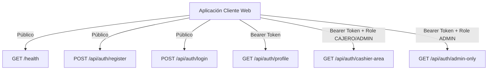
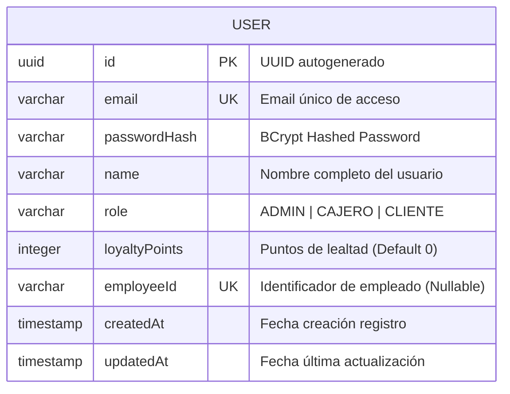

# 🛒 Sistema de Diseño: Supermarket App (SDS)
### Arquitectura Visual, Tokens, Componentes y Flujos de Usuario basados en `SupermarketApi`

> **Documento Técnico & Guía de Diseño de Interfaz**  
> **Proyecto:** Supermarket API (Spring Boot 3 + Java 17 + PostgreSQL / H2 + JWT)  
> **Aplicación Cliente:** Frontend Web (React 19 + Vite + Axios)  
> **Versión del Sistema de Diseño:** 1.0.0  
> **Autor:** Antigravity AI Architecture Team  
> **Fecha:** Octubre 2026  

---

## 📑 Tabla de Contenidos
1. [Análisis Integral del Backend (`SupermarketApi`)](#1-análisis-integral-del-backend-supermarketapi)
   - [1.1 Stack Tecnológico & Configuración](#11-stack-tecnológico--configuración)
   - [1.2 Catálogo y Matriz Completa de Endpoints](#12-catálogo-y-matriz-completa-de-endpoints)
   - [1.3 Modelo de Datos y Entidades de Dominio](#13-modelo-de-datos-y-entidades-de-dominio)
   - [1.4 Mecanismo de Seguridad y Ciclo de Vida del JWT](#14-mecanismo-de-seguridad-y-ciclo-de-vida-del-jwt)
   - [1.5 Contrato Estándar de Respuestas y Errores](#15-contrato-estándar-de-respuestas-y-errores)
2. [Filosofía y Fundamentos de Diseño](#2-filosofía-y-fundamentos-de-diseño)
   - [2.1 Propósito y Arquetipos de Usuario (RBAC)](#21-propósito-y-arquetipos-de-usuario-rbac)
   - [2.2 Principios Rectores](#22-principios-rectores)
3. [Design Tokens (Tokens de Diseño)](#3-design-tokens-tokens-de-diseño)
   - [3.1 Paleta Cromática Semántica y de Roles](#31-paleta-cromática-semántica-y-de-roles)
   - [3.2 Colores de Códigos de Estado HTTP](#32-colores-de-códigos-de-estado-http)
   - [3.3 Tipografía y Jerarquía](#33-tipografía-y-jerarquía)
   - [3.4 Espaciado, Grilla y Layout](#34-espaciado-grilla-y-layout)
   - [3.5 Radios de Borde y Elevaciones (Sombras)](#35-radios-de-borde-y-elevaciones-sombras)
   - [3.6 Transiciones y Microinteracciones](#36-transiciones-y-microinteracciones)
4. [Arquitectura de Vistas & Flujos de Usuario según Endpoints](#4-arquitectura-de-vistas--flujos-de-usuario-según-endpoints)
   - [4.1 Mapeo de Rutas Frontend vs Endpoints API](#41-mapeo-de-rutas-frontend-vs-endpoints-api)
   - [4.2 Flujo 1: Conectividad y Salud del Servidor (`/health`)](#42-flujo-1-conectividad-y-salud-del-servidor-health)
   - [4.3 Flujo 2: Autenticación y Acceso (`/api/auth/login`)](#43-flujo-2-autenticación-y-acceso-apiauthlogin)
   - [4.4 Flujo 3: Registro Inteligente Multirrol (`/api/auth/register`)](#44-flujo-3-registro-inteligente-multirrol-apiauthregister)
   - [4.5 Flujo 4: Perfil de Usuario y Fidelización (`/api/auth/profile`)](#45-flujo-4-perfil-de-usuario-y-fidelización-apiauthprofile)
   - [4.6 Flujo 5: Terminal de Facturación de Cajero (`/api/auth/cashier-area`)](#46-flujo-5-terminal-de-facturación-de-cajero-apiauthcashier-area)
   - [4.7 Flujo 6: Consola de Mando de Administrador (`/api/auth/admin-only`)](#47-flujo-6-consola-de-mando-de-administrador-apiauthadmin-only)
   - [4.8 Flujos de Excepción: Estados 401 y 403](#48-flujos-de-excepción-estados-401-y-403)
5. [Biblioteca de Componentes UI (Atomic Design)](#5-biblioteca-de-componentes-ui-atomic-design)
   - [5.1 Átomos](#51-átomos)
   - [5.2 Moléculas](#52-moléculas)
   - [5.3 Organismos](#53-organismos)
6. [Implementación Técnica de Código (Tokens CSS & Componentes React)](#6-implementación-técnica-de-código-tokens-css--componentes-react)
   - [6.1 Archivo `tokens.css` (Variables CSS Puramente Nativas)](#61-archivo-tokenscss-variables-css-puramente-nativas)
   - [6.2 Interceptor de Axios para Bearer Token y Manejo de Errores](#62-interceptor-de-axios-para-bearer-token-y-manejo-de-errores)
   - [6.3 Componente `RoleBadge.jsx`](#63-componente-rolebadgejsx)
   - [6.4 Componente `PasswordInput.jsx` con Validador Dinámico](#64-componente-passwordinputjsx-con-validador-dinámico)
   - [6.5 Componente `EmployeeIdField.jsx` (Lógica Condicional de Rol)](#65-componente-employeeidfieldjsx-lógica-condicional-de-rol)
   - [6.6 Componente `ApiHealthPill.jsx`](#66-componente-apihealthpilljsx)
7. [Roadmap y Extensibilidad del Dominio Supermercado](#7-roadmap-y-extensibilidad-del-dominio-supermercado)

---

## 1. Análisis Integral del Backend (`SupermarketApi`)

El proyecto **`SupermarketApi`** es una API RESTful desarrollada con **Spring Boot 3.2.5** y **Java 17**. Su diseño sigue una arquitectura por capas desacoplada y orientada a la seguridad, implementando un esquema de **Role-Based Access Control (RBAC)** con tokens criptográficos JWT y persistencia dual (base de datos en memoria **H2** para desarrollo inmediato y **PostgreSQL 15** mediante Docker para entornos de producción).

### 1.1 Stack Tecnológico & Configuración

| Parámetro | Valor / Tecnología | Observación |
| :--- | :--- | :--- |
| **Lenguaje** | Java 17 (OpenJDK / Eclipse Temurin) | Uso de Records, switch expressions y lambdas |
| **Framework Base** | Spring Boot 3.2.5 | `spring-boot-starter-web`, `validation`, `security`, `data-jpa` |
| **CORS** | `*` (Orígenes, Cabeceras y Métodos permitidos) | Configurado en `SecurityConfig.java` para consumo desacoplado |
| **Puerto del Servidor** | `3000` (`server.port=3000`) | Configurado en `application.properties` |
| **Base de Datos Local** | H2 Database (`jdbc:h2:mem:supermercado_db`) | Consola web habilitada en `/h2-console` |
| **Base de Datos Producción** | PostgreSQL 15 Alpine (`supermercado_db`) | Orquestado vía `docker-compose.yml` en puerto 5432 |
| **Manejo de Contraseñas** | BCrypt (`BCryptPasswordEncoder`) | Hash unidireccional seguro |
| **Librería JWT** | `io.jsonwebtoken` (JJWT 0.12.5) | Firma HMAC-SHA256 con algoritmo HS256 |
| **Vencimiento de Token** | 24 Horas (`86400000 ms`) en dev / 8h en Docker | Clave de seguridad configurada en `jwt.secret` |

---

### 1.2 Catálogo y Matriz Completa de Endpoints



A continuación se detalla el comportamiento exacto de cada uno de los endpoints registrados en el backend:

#### 1. `GET /health`
- **Controlador:** `HealthController.java`
- **Nivel de Acceso:** Público (sin autenticación).
- **Finalidad:** Comprobación de estado operativo del servidor (Liveness / Readiness Probe).
- **Respuesta Exitosa (`200 OK`):**
  ```json
  {
    "status": "OK",
    "message": "API funcionando correctamente"
  }
  ```

#### 2. `POST /api/auth/register`
- **Controlador:** `AuthController.java` -> `AuthServiceImpl.java`
- **Nivel de Acceso:** Público.
- **Payload Requerido (`RegisterRequest`):**
  ```json
  {
    "name": "Carlos Mendoza",
    "email": "carlos@supermercado.com",
    "password": "Password123",
    "role": "CLIENTE",
    "employeeId": null
  }
  ```
- **Reglas de Negocio y Validaciones de Entrada:**
  1. `name`: Obligatorio, mínimo 2 caracteres.
  2. `email`: Obligatorio, formato de correo válido y único en la base de datos (lanza `400 Bad Request` si ya existe).
  3. `password`: Mínimo 8 caracteres, al menos 1 letra mayúscula y al menos 1 número (`Pattern: .*?[A-Z].*` y `.*?[0-9].*`).
  4. `role`: Opcional en el JSON (toma `CLIENTE` por defecto). Valores aceptados: `"CLIENTE"`, `"CAJERO"`, `"ADMIN"`.
  5. `employeeId`: **Obligatorio** si `role` es `"CAJERO"` o `"ADMIN"`. Si se proporciona, debe ser único en la base de datos (lanza `400 Bad Request` si ya existe). Para `"CLIENTE"`, se guarda como `null`.
- **Respuesta Exitosa (`201 Created`):**
  ```json
  {
    "status": "success",
    "message": "Usuario registrado exitosamente",
    "data": {
      "id": "c1f10bc4-8b65-4a6c-9c71-0810db61a7a0",
      "email": "carlos@supermercado.com",
      "name": "Carlos Mendoza",
      "role": "CLIENTE",
      "loyaltyPoints": 0,
      "employeeId": null,
      "createdAt": "2026-10-05T16:20:00",
      "updatedAt": "2026-10-05T16:20:00"
    }
  }
  ```

#### 3. `POST /api/auth/login`
- **Controlador:** `AuthController.java` -> `AuthServiceImpl.java`
- **Nivel de Acceso:** Público.
- **Payload Requerido (`LoginRequest`):**
  ```json
  {
    "email": "admin@correo.com",
    "password": "AdminPassword123"
  }
  ```
- **Comportamiento:** Compara el hash con BCrypt. Si falla el email o la contraseña, devuelve `401 Unauthorized` con mensaje `"Credenciales inválidas"`.
- **Respuesta Exitosa (`200 OK`):**
  ```json
  {
    "status": "success",
    "message": "Autenticación exitosa",
    "data": {
      "token": "eyJhbGciOiJIUzI1NiIsInR5cCI6IkpXVCJ9.eyJzdWIiOiJjMWYxMGJjNC04YjY1LTRhNmMtOWM3MS0wODEwZGI2MWE3YTAiLCJyb2xlIjoiUk9MRV9BRE1JTiIsImlhdCI6MTY5NjUyNjgwMCwiZXhwIjoxNjk2NjEzMjAwfQ...",
      "user": {
        "id": "c1f10bc4-8b65-4a6c-9c71-0810db61a7a0",
        "email": "admin@correo.com",
        "name": "Administrador Principal",
        "role": "ADMIN"
      }
    }
  }
  ```

#### 4. `GET /api/auth/profile`
- **Controlador:** `AuthController.java`
- **Nivel de Acceso:** Requiere cabecera `Authorization: Bearer <token>` (Cualquier usuario autenticado).
- **Respuesta Exitosa (`200 OK`):**
  ```json
  {
    "message": "Perfil de usuario",
    "user": {
      "userId": "c1f10bc4-8b65-4a6c-9c71-0810db61a7a0",
      "role": "ADMIN"
    }
  }
  ```

#### 5. `GET /api/auth/cashier-area`
- **Controlador:** `AuthController.java`
- **Nivel de Acceso:** Protegido con Spring Security (`hasAnyRole("ADMIN", "CAJERO")`).
- **Respuesta Exitosa (`200 OK`):**
  ```json
  {
    "message": "Área de facturación y validación"
  }
  ```

#### 6. `GET /api/auth/admin-only`
- **Controlador:** `AuthController.java`
- **Nivel de Acceso:** Protegido con Spring Security (`hasRole("ADMIN")`).
- **Respuesta Exitosa (`200 OK`):**
  ```json
  {
    "message": "Bienvenido, Administrador"
  }
  ```

---

### 1.3 Modelo de Datos y Entidades de Dominio

La entidad JPA central es `User` (`com.supermarket.api.entity.User`), mapeada a la tabla `users`:



---

### 1.4 Mecanismo de Seguridad y Ciclo de Vida del JWT

1. **Generación**: Al iniciar sesión (`POST /api/auth/login`), `JwtService` emite un token con:
   - `Subject`: ID del usuario (`UUID.toString()`).
   - `Claim "role"`: `"ROLE_" + user.getRole().name()` (ej. `ROLE_ADMIN`).
   - `IssuedAt` & `Expiration`.
2. **Filtro de Peticiones (`JwtAuthenticationFilter`)**: Intercepta cada solicitud entrante, extrae el Bearer token, valida la firma criptográfica y establece el contexto de seguridad en `SecurityContextHolder`.
3. **Manejo de Errores de Seguridad (`SecurityConfig`)**:
   - `AuthenticationEntryPoint` (`401 Unauthorized`): Si el token no existe, está alterado o expiró.
   - `AccessDeniedHandler` (`403 Forbidden`): Si el usuario autenticado intenta ingresar a un recurso para el cual su rol no tiene privilegios.

---

### 1.5 Contrato Estándar de Respuestas y Errores

Tanto las respuestas de éxito como los fallos capturados por `GlobalExceptionHandler` siguen la estructura unificada de la clase `ApiResponse<T>`:

```json
// Estructura Genérica
{
  "status": "success | error",
  "message": "Descripción clara del resultado",
  "data": { ... } // Solo presente en respuestas exitosas con payload
}
```

---

## 2. Filosofía y Fundamentos de Diseño

El Sistema de Diseño **Supermarket Design System (SDS)** está concebido para unificar la experiencia de compra de los clientes y la eficiencia operativa de los empleados del supermercado.

### 2.1 Propósito y Arquetipos de Usuario (RBAC)

1. **Arquetipo CLIENTE (Shopper / Consumidor Final)**:
   - **Enfoque UX:** Calidez, claridad de precios, consulta rápida de saldo y puntos de lealtad (`loyaltyPoints`), simplicidad en el registro.
   - **Tono Visual:** Fresco, amigable, con toques verdes orgánicos y tarjetas de lealtad destacadas.
2. **Arquetipo CAJERO (Punto de Venta / Terminal de Caja)**:
   - **Enfoque UX:** Alta velocidad, alto contraste visual, tipografía monoespaciada para códigos y montos, atajos de teclado, botones táctiles grandes para pantallas de POS.
   - **Tono Visual:** Enérgico, enfocado en estado de caja, alertas claras de cobro y validación de identidad.
3. **Arquetipo ADMINISTRADOR (Gestión & Gobernanza)**:
   - **Enfoque UX:** Densidad de datos equilibrada, métricas ejecutivas, control de empleados y perfiles, visualización de logs de seguridad y estado de los servicios.
   - **Tono Visual:** Sobrio, índigo/púrpura profundo, tarjetas analíticas y badges de autorización.

---

## 3. Design Tokens (Tokens de Diseño)

### 3.1 Paleta Cromática Semántica y de Roles

- **Brand Primario:** `#10B981` (Esmeralda fresco de supermercado)
- **Rol CLIENTE:** `#10B981` (Verde Esmeralda - Salud, frescura, puntos de fidelidad)
- **Rol CAJERO:** `#F59E0B` (Ámbar Dorado - Terminal de cobro rápido, dinamismo)
- **Rol ADMIN:** `#6366F1` (Índigo Royal - Gobernanza, permisos totales)

### 3.2 Colores de Códigos de Estado HTTP
- **`200/201 Success`**: `#10B981`
- **`400 Bad Request`**: `#F43F5E`
- **`401 Unauthorized`**: `#F59E0B`
- **`403 Forbidden`**: `#EF4444`
- **`500 Server Error`**: `#881337`

---

## 4. Arquitectura de Vistas & Flujos de Usuario según Endpoints

### 4.1 Mapeo de Rutas Frontend vs Endpoints API

| Ruta Frontend | Componente / Vista | Endpoint(s) Vinculado(s) | Roles con Acceso |
| :--- | :--- | :--- | :--- |
| `/*` (Global Navbar) | `ServerHealthIndicator` | `GET /health` | Público |
| `/login` | `LoginPage` | `POST /api/auth/login` | Público |
| `/register` | `RegisterPage` | `POST /api/auth/register` | Público |
| `/profile` | `UserProfileModal` / `ProfileView` | `GET /api/auth/profile` | Autenticado (`CLIENTE`, `CAJERO`, `ADMIN`) |
| `/pos` o `/cashier` | `CashierWorkstation` | `GET /api/auth/cashier-area` | `CAJERO` y `ADMIN` |
| `/admin` | `AdminControlCenter` | `GET /api/auth/admin-only` | Exclusivo `ADMIN` |
| `/403` | `ForbiddenAccessPage` | Interceptor de `403` | Autenticado con rol no permitido |

---

## 5. Biblioteca de Componentes UI (Atomic Design)

- **Átomos:** `Button`, `Input`, `RoleBadge`, `StatusPill`, `Avatar`.
- **Moléculas:** `PasswordInput` con medidor de validación, `EmployeeIdField` con visibilidad condicional, `LoyaltyPointsWidget`, `AlertBanner`.
- **Organismos:** `AppNavbar` con RBAC, `AuthCardContainer`, `CashierPOSGrid`, `AdminEmployeeTable`.

---

## 6. Implementación Técnica de Código (Tokens CSS & Componentes React)

Consultar el archivo principal [SISTEMA_DE_DISENO_SUPERMARKET_API.md](file:///c:/Users/Usuario/OneDrive/Desktop/VINCULACION/wachapa/Prouecto%20ingenieria%20web/SISTEMA_DE_DISENO_SUPERMARKET_API.md) en la raíz del proyecto para ver la totalidad de los archivos de código listos para producción (`tokens.css`, `axios.js`, `RoleBadge.jsx`, `PasswordInput.jsx`, etc.).

---

> **Supermarket API Design System - Documento Sincronizado**
